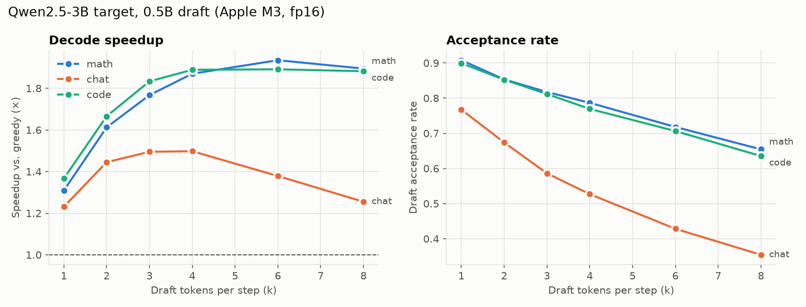
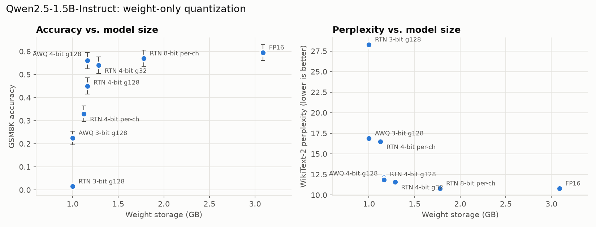

# LLM Inference Efficiency Benchmark

From-scratch implementations of two techniques that make LLMs cheaper to serve, benchmarked on Qwen2.5 models on an Apple M3 (16 GB, PyTorch MPS, fp16):

1. **Speculative decoding**: a 0.5B draft model proposes tokens and a larger target model verifies them in one forward pass ([`specdec/speculative.py`](specdec/speculative.py)).
2. **Weight-only post-training quantization**: round-to-nearest (RTN) and AWQ-style activation-aware scaling at 3, 4 and 8 bits ([`quant/quantize.py`](quant/quantize.py)).

No inference library does the work here. Both techniques are implemented directly on Hugging Face `transformers` models and their KV caches.

## Key results

| | Result |
|---|---|
| Speculative decoding, 3B target, 0.5B draft | **1.75× faster decoding** at k=4 (11.0 → 19.2 tokens/s), up to **1.94×** on math prompts |
| Draft acceptance rate | 91% at k=1 on math, down to 35% at k=8 on open-ended chat |
| Quantization, AWQ-style 4-bit (g128) | **62% smaller weights** (3.09 → 1.16 GB) for **−3.5 pts GSM8K** (59.5% → 56.0%) |
| AWQ vs. plain RTN at the same 4-bit size | AWQ recovers **11 of the 14.5 points** RTN loses (45.0% → 56.0%) |

## 1. Speculative decoding

**How it works.** Each step, the draft model greedily proposes `k` tokens. The target model scores all `k` in a single forward pass and accepts the longest prefix that matches its own greedy choice, plus one "bonus" token from its own prediction. Both KV caches are then rolled back to the accepted prefix. Under greedy decoding the output should equal plain target decoding. Every run is checked against a plain greedy baseline, token for token.

**Setup.** 60 prompts (20 GSM8K math, 20 MT-Bench chat, 20 HumanEval code), 128 new tokens, batch size 1, fp16, greedy decoding. Speedup is wall-clock tokens/s against a greedy KV-cached baseline using the same code path.



| k | Speedup (all tasks) | Acceptance | Runs token-identical to baseline |
|--:|--:|--:|--:|
| 1 | 1.30× | 86.0% | 95% |
| 2 | 1.58× | 79.2% | 95% |
| 3 | 1.70× | 73.3% | 95% |
| **4** | **1.75×** | 68.5% | 95% |
| 6 | 1.71× | 60.0% | 95% |
| 8 | 1.64× | 52.3% | 97% |

**What the ablations show**
- **The best k depends on the task.** Math and code keep improving up to k=4–6 (1.89–1.94×) because the draft predicts structured text well (77–91% acceptance at k≤4). Chat peaks at k=3–4 (1.50×) and then *declines*: past that point, wasted draft compute outweighs accepted tokens.
- **The target/draft size ratio matters.** With a 1.5B target and the same 0.5B draft, the best speedup falls to **1.33×** (k=4) even though acceptance is similar (78%). The draft is a larger fraction of the target's cost, so each rejected token costs relatively more.
- **Correctness.** On the 1.5B pair, 100% of runs are token-identical to plain decoding. On the 3B pair, 5 of 60 prompts diverge, at token 36–90 of 128. That's consistent with fp16 numerical near-ties flipping an argmax when attention runs over k+1 tokens instead of 1. It is *not* verified in fp32 (see Limitations).

Full per-task tables are in [`results/summary.md`](results/summary.md).

## 2. Weight-only quantization

**How it works.**
- **RTN:** asymmetric quantization (scale and zero point) over groups of input channels, applied to every linear layer in the transformer blocks. Embeddings and the LM head stay fp16.
- **AWQ-style:** input channels with large average activation magnitude are scaled up by `s = mean|x|^α` before quantization, and the inverse is applied to the activations, so salient weights keep more precision. α is grid-searched per layer (0 to 1) to minimize output MSE on WikiText-2 calibration activations (64 × 512 tokens).

Weights are fake-quantized: quantized, then dequantized to fp16. The model therefore computes exactly what a low-bit kernel would, without custom kernels. **Size is the computed packed storage** (b bits per weight plus an fp16 scale and zero point per group). It was not measured from a real low-bit runtime.

**Setup.** Qwen2.5-1.5B-Instruct. WikiText-2 test perplexity (1,024-token windows, full test set). GSM8K accuracy on 200 random test problems, zero-shot chain-of-thought, greedy.



| Config | Weights (GB) | Size reduction | WikiText-2 PPL | GSM8K acc. | Δ vs FP16 |
|---|--:|--:|--:|--:|--:|
| FP16 | 3.09 | — | 10.80 | 59.5% | — |
| RTN 8-bit, per-channel | 1.78 | 42% | 10.80 | 57.0% | −2.5 |
| RTN 4-bit, per-channel | 1.12 | 64% | 16.50 | 33.0% | −26.5 |
| RTN 4-bit, group 128 | 1.16 | 62% | 12.10 | 45.0% | −14.5 |
| RTN 4-bit, group 32 | 1.29 | 58% | 11.60 | 54.0% | −5.5 |
| **AWQ 4-bit, group 128** | **1.16** | **62%** | **11.83** | **56.0%** | **−3.5** |
| RTN 3-bit, group 128 | 1.00 | 68% | 28.29 | 1.5% | −58.0 |
| AWQ 3-bit, group 128 | 1.00 | 68% | 16.89 | 22.5% | −37.0 |

**What the ablations show**
- **8-bit is effectively lossless.** Perplexity is unchanged, and the −2.5-point GSM8K difference is within noise (±3.5 points standard error at n=200).
- **Group size is the biggest lever for plain RTN at 4 bits.** Moving from per-channel to g128 to g32 takes GSM8K from 33% to 45% to 54%, at +0.04 to +0.16 GB.
- **Activation-aware scaling beats finer groups.** AWQ at g128 (56.0%) matches or exceeds RTN at g32 (54.0%) while being 10% smaller. It's the best quality-per-byte config tested.
- **At 3 bits, RTN collapses** (1.5% GSM8K). AWQ keeps the model partly functional (22.5%), but neither is usable for reasoning. Multi-step reasoning degrades far faster than perplexity suggests: perplexity rises only 1.6× from FP16 for AWQ 3-bit, while accuracy drops 2.6×.

## Limitations

- **Hardware.** Apple M3 GPU (MPS), batch size 1. Speedups on datacenter GPUs, at larger batch sizes or with optimized kernels will differ.
- **fp16 divergence not isolated.** The 3B divergences are attributed to fp16 near-ties but not confirmed with an fp32 run, which doesn't fit in 16 GB alongside the draft.
- **Quantization is simulated.** There are no latency numbers, because fake-quantized weights run at fp16 speed. Sizes are computed, not measured.
- **This is not the official AWQ.** Scales are applied analytically rather than folded into the preceding LayerNorm, the search is a simple per-layer grid, and calibration uses WikiText-2.
- **Sample sizes.** GSM8K n=200 (±3.5 points standard error). Speculative decoding uses 20 prompts per task at 128 tokens. Treat differences under ~1 standard error as noise.
- **Greedy decoding only.** Speculative *sampling* (rejection sampling for temperature > 0) is not implemented.

## Reproduce

```bash
python3.12 -m venv .venv && .venv/bin/pip install -r requirements.txt
.venv/bin/python -c "from huggingface_hub import snapshot_download as d; [d(f'Qwen/Qwen2.5-{s}-Instruct', local_dir=f'models/Qwen2.5-{s}-Instruct') for s in ['0.5B','1.5B','3B']]"
./run_all.sh            # a few hours on an M3; writes results/*.jsonl
.venv/bin/python analyze.py   # writes results/summary.md and plots/*.png
```

## Repository layout

```
common.py                  model loading, prompt datasets, answer parsing
specdec/speculative.py     greedy speculative decoding with KV-cache rollback
specdec/run_benchmark.py   speedup / acceptance / correctness benchmark
quant/quantize.py          RTN + AWQ-style quantization, packed-size accounting
quant/run_benchmark.py     WikiText-2 perplexity + GSM8K accuracy
analyze.py                 tables and plots
results/                   raw JSONL results, per-problem GSM8K outputs, summary
```
